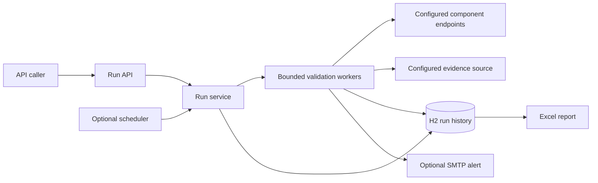

# ReleaseGuard

A Java 21 service that validates configured application components after a release, records each check, and produces an Excel report. It demonstrates a practical backend workflow: accept a bounded validation request, run HTTP checks asynchronously, persist the results, and notify a team when a completed run fails.

This is an educational reference implementation and a new personal project. Its demonstration endpoints and evidence use original sample data. It is not a claim that this application was used in production or accepted as a contribution to an existing open-source project.

## What it does

- Starts validation runs for an allowlist of configured components; callers select component IDs and cannot submit arbitrary target URLs.
- Checks HTTP status and expected response content over a configurable window, records latency, and applies bounded retries for temporary failures.
- Persists run summaries and individual check results in a local H2 database.
- Supports run history, cancellation, Excel reports, optional Elasticsearch evidence, optional SMTP notifications, and optional scheduled validation.
- Exposes application health, metrics, and Prometheus metrics.
- Provides a self-contained demo with healthy, failing, slow, and intermittently failing components.

The default configuration permits at most two concurrent runs, a 300-second validation window, and 300 planned checks per run. The limits keep the demonstration workload bounded; they are not measured capacity claims.

## Run locally

Install a Java 21 JDK. The included Maven Wrapper downloads Maven and project dependencies on the first run, so that initial setup requires network access.

From the project directory on Windows PowerShell:

```powershell
.\mvnw.cmd -B verify
.\mvnw.cmd spring-boot:run
```

On Linux or macOS:

```bash
chmod +x mvnw
./mvnw -B verify
./mvnw spring-boot:run
```

The default `demo` profile listens on `127.0.0.1:8080`. API calls use the `X-API-Key` header; the local demo key is `local-demo-key`. Set `RELEASEGUARD_API_KEY` to change it. H2 stores data under `./data/releaseguard`; run the application from the same working directory to reuse that history. Stop it with Ctrl+C. Unfinished runs from the previous process are marked `ABORTED` at startup.

To run the packaged application after verification:

```powershell
java -jar target/release-readiness-service-0.1.0.jar
```

Use the actual JAR filename in `target/` if the project version changes.

The separately supplied `ReleaseGuard-0.1.0.jar` is ready to run with Java 21:

```text
java -jar ReleaseGuard-0.1.0.jar
```

If Maven is already installed, `mvn -B clean verify` and `mvn spring-boot:run` are alternatives to the wrapper commands.

## Try the failure-to-recovery demo

The demo starts with `catalog=UP`, `payments=DOWN`, and `identity=UP`. The initial run therefore demonstrates a failed release check. These are local sample endpoints, not real application dependencies.

### PowerShell

Open a second terminal while the application is running:

```powershell
$base = 'http://127.0.0.1:8080'
$headers = @{ 'X-API-Key' = 'local-demo-key' }
Invoke-RestMethod "$base/api/components" -Headers $headers

$body = @{
    release = 'demo-v1'
    componentIds = @('catalog', 'payments', 'identity')
    windowSeconds = 6
    intervalSeconds = 2
} | ConvertTo-Json

$run = Invoke-RestMethod "$base/api/runs" -Method Post -Headers $headers `
    -ContentType 'application/json' -Body $body
$run.id

do {
    Start-Sleep -Seconds 1
    $details = Invoke-RestMethod "$base/api/runs/$($run.id)" -Headers $headers
    $details.run | Select-Object id, status, totalChecks, failedChecks
} while ($details.run.status -in @('QUEUED', 'RUNNING'))

Invoke-WebRequest "$base/api/runs/$($run.id)/report.xlsx" `
    -Headers $headers -OutFile './demo-failed-report.xlsx'

Invoke-RestMethod "$base/demo/components/payments/mode" -Method Post -Headers $headers `
    -ContentType 'application/json' -Body '{"mode":"UP"}'

# Repeat the same validation against the now-healthy components.
$recoveryRun = Invoke-RestMethod "$base/api/runs" -Method Post -Headers $headers `
    -ContentType 'application/json' -Body $body
$recoveryRun
```

### Linux or macOS

```bash
API_KEY='local-demo-key'
curl -s -H "X-API-Key: $API_KEY" http://127.0.0.1:8080/api/components

curl -s -X POST http://127.0.0.1:8080/api/runs \
  -H "X-API-Key: $API_KEY" \
  -H 'Content-Type: application/json' \
  -d '{"release":"demo-v1","componentIds":["catalog","payments","identity"],"windowSeconds":6,"intervalSeconds":2}'
```

Copy the returned `id` into `RUN_ID`, then poll the run until its status is terminal:

```bash
RUN_ID='paste-the-returned-id-here'
curl -s -H "X-API-Key: $API_KEY" "http://127.0.0.1:8080/api/runs/$RUN_ID"
```

Download the report after completion and make the failing component healthy:

```bash
curl --fail -H "X-API-Key: $API_KEY" -o demo-failed-report.xlsx \
  "http://127.0.0.1:8080/api/runs/$RUN_ID/report.xlsx"

curl -s -X POST http://127.0.0.1:8080/demo/components/payments/mode \
  -H "X-API-Key: $API_KEY" \
  -H 'Content-Type: application/json' -d '{"mode":"UP"}'
```

Submit another `POST /api/runs` request to demonstrate recovery. The response to starting a run is an acceptance acknowledgement, not a completed validation result.

## API

Supply `X-API-Key` for every `/api/**` request, protected Actuator endpoints, and demo mode changes. `/actuator/health` and demo health/evidence GET endpoints are available without that header. The shared key is a simple local access control; it does not provide per-user roles or an identity system.

| Method | Path | Purpose |
| --- | --- | --- |
| `GET` | `/api/components` | List configured component IDs and public validation rules. |
| `POST` | `/api/runs` | Accept a valid run request and return `202` with a `RunSummary`. |
| `GET` | `/api/runs` | Return the 20 most recent run summaries. |
| `GET` | `/api/runs/{id}` | Return `{ "run": RunSummary, "checks": [...] }`. |
| `POST` | `/api/runs/{id}/cancel` | Request cancellation of a queued or running validation. |
| `GET` | `/api/runs/{id}/report.xlsx` | Download a terminal run's `Summary` and `Checks` worksheets; active runs return `409`. |
| `GET` | `/actuator/health` | Application health. |
| `GET` | `/actuator/metrics` | Available application metrics. |
| `GET` | `/actuator/prometheus` | Prometheus-format metrics. |

A run summary includes its UUID, release label, timestamps, status, component IDs, requested window and interval, check counts, a message, and notification status. A check result includes its component, timestamp, success flag, HTTP status, latency, attempt count, message, and available evidence.

Run statuses are `QUEUED`, `RUNNING`, `PASSED`, `FAILED`, `CANCELLED`, and `ABORTED`. The last four are terminal. A failed check remains part of the run's history even if a later check succeeds; use a new run to establish a fresh result after a fix.

Notification status is separate. It starts as `PENDING` and can remain pending briefly after the run becomes terminal while reporting and delivery finish. It then becomes `SENT`, `FAILED`, `DISABLED`, or `NOT_REQUIRED`. On restart, a terminal run with pending delivery becomes `INTERRUPTED`: the validation result stays unchanged, delivery is uncertain, and the service does not replay the notification.

Demo-only endpoints:

| Method | Path | Purpose |
| --- | --- | --- |
| `GET` | `/demo/components/{id}/health` | Sample health response for `catalog`, `payments`, or `identity`. |
| `POST` | `/demo/components/{id}/mode` | Set `{"mode":"UP"}`, `DOWN`, `SLOW`, or `FLAKY`. |
| `GET` | `/demo/evidence/{id}` | Read synthetic evidence for a sample component. |

## Docker and local email preview

Docker Compose runs the service and Mailpit. Mailpit captures the demo's email inside the local stack; the supplied configuration does not relay it to an external mailbox.

```bash
docker compose up --build
```

- Application: <http://127.0.0.1:8080>
- Mailpit inbox: <http://127.0.0.1:8025>

Submit the failing demo run and inspect the captured notification. Compose enables alerts for this demonstration; ordinary local execution keeps them disabled. Only completed failed runs are eligible for failure notifications.

```bash
docker compose down
```

The named data volume retains run history across container recreation. Container ports are bound to localhost on the host. The application listens on `0.0.0.0` inside its container so that port forwarding and the local Compose network can reach it.

## Configuration

The source of truth is `src/main/resources/application.yml`. Components and their rules are operator configuration; the start-run request references IDs from that configuration. The component listing excludes authentication secrets.

| Area | Default or behavior |
| --- | --- |
| Runtime | Java 21, Spring Boot 4.1.1. |
| API key | `releaseguard.api-key`; override with `RELEASEGUARD_API_KEY`. |
| Persistence | File-backed H2 at `./data/releaseguard`; single application instance. |
| Active runs | At most 2 by default. |
| Validation | At most 300 seconds and 300 planned checks per run by default. |
| Retries | Bounded retries for `408`, `429`, `5xx`, and transport I/O failures. |
| Redirects | HTTP redirects are not followed. |
| History | `releaseguard.retained-runs` defaults to 100 finalized terminal runs; active runs and terminal runs with `PENDING` notifications are protected and excluded from this count. The recent-runs API returns at most 20 items. |
| Scheduling | Disabled by default; configurable cron-based validation. |
| Email | Disabled by default; opt in with `releaseguard.alerts.enabled`. |
| Elasticsearch | Disabled by default; demo checks use synthetic local evidence. |

The workload properties are `releaseguard.max-concurrent-runs`, `releaseguard.max-window-seconds`, `releaseguard.max-checks-per-run`, `releaseguard.max-attempts`, and `releaseguard.retry-backoff`. The defaults use three attempts and a 100 ms retry backoff. Scheduled runs use `releaseguard.schedule.enabled`, `cron`, `window-seconds`, and `interval-seconds`; the configured cron expression defaults to every five minutes while scheduling remains disabled.

The first check round starts immediately. Components in a round are checked in parallel. Subsequent rounds target fixed time slots measured from run start, such as 0, 2, 4, and 6 seconds for a two-second interval. Rounds do not overlap; slots missed while a previous round is still running are skipped. A bounded HTTP request or evidence lookup already in progress can finish after the requested window. The interval is a sampling target, not a promise of an exact number of observations.

To use your own configured components, edit [examples/application-custom.yml](examples/application-custom.yml). Its localhost URLs are sample addresses for services you run separately; replace them with your component health URLs and expected responses. After building, launch from the project directory:

```text
java -jar target/release-readiness-service-0.1.0.jar --spring.profiles.active=custom --spring.config.additional-location=file:./examples/
```

The additional directory supplies `application-custom.yml` while retaining the base configuration. Selecting `custom` disables the default `demo` profile and its sample controllers. The example contains no credentials and keeps alerts, scheduling, and Elasticsearch disabled.

For optional Elasticsearch evidence, configure `releaseguard.elasticsearch.enabled`, `url`, `index`, and `api-key` (also supplied through `ELASTICSEARCH_API_KEY`). The adapter filters by `@timestamp` and `service.name`, requests selected fields from at most 10 hits, and bounds the response body. Match these fields to your own log schema before expecting useful results. The project does not connect to an external Elasticsearch service by default.

To configure a real SMTP server, set `releaseguard.alerts.enabled`, `releaseguard.alerts.from`, `releaseguard.alerts.to`, and the corresponding `spring.mail.*` settings for that server. Keep credentials in environment variables or an appropriate secret store; do not commit them. For example, the environment names are `RELEASEGUARD_ALERTS_ENABLED`, `RELEASEGUARD_ALERTS_FROM`, `RELEASEGUARD_ALERTS_TO`, `SPRING_MAIL_HOST`, and `SPRING_MAIL_PORT`.

## Design



See [architecture](docs/architecture.md) for lifecycle and tradeoffs, and the [interview walkthrough](docs/interview-walkthrough.md) for a concise way to demonstrate and explain the code.

## Verification and scope

The local verification on 9 October 2026 passed all 52 tests and the packaged application's failure, recovery, retry, cancellation, report, and metrics checks. See [the verification record](docs/verification.md) for results and untested integrations.

Run `./mvnw -B verify` or `.\mvnw.cmd -B verify` before reviewing changes. The GitHub Actions workflow runs Maven verification on Java 21 and uploads the JaCoCo report when generated. It contains no deployment, release, or repository-push step.

The repository implements a useful local demonstration, not a production release gate. It deliberately uses a single-node database and in-process execution. It has no distributed run coordination, durable notification outbox, or high-availability design. Review identity and role-based access, destination controls, retention, secrets, and operational behavior before using it beyond a trusted local environment. See the architecture document for the concrete limitations.

This is a personal portfolio project. It is separate from employer work and from contributions reviewed by maintainers of other open-source projects.
