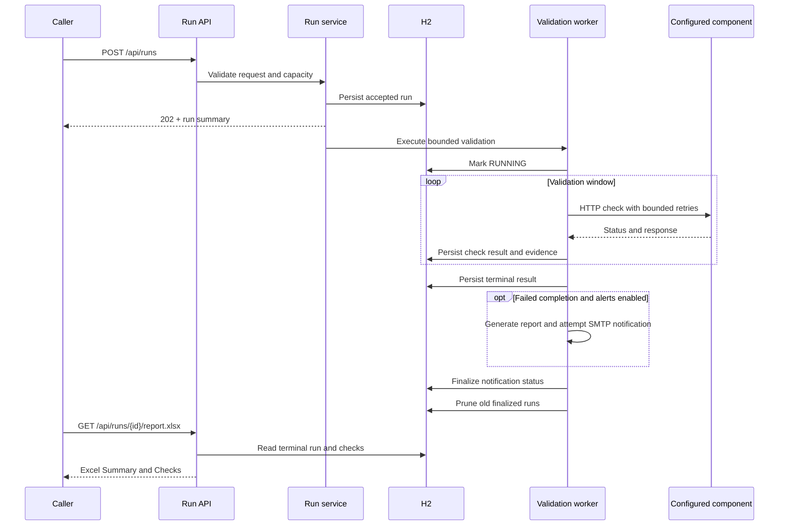
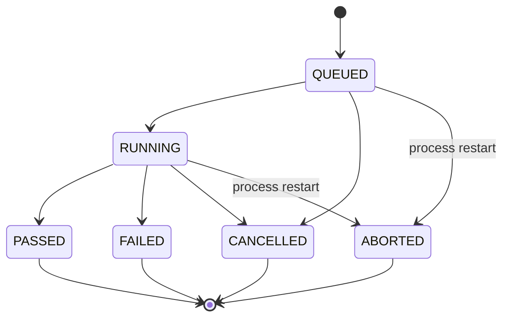

# ReleaseGuard architecture

ReleaseGuard models a post-deployment validation workflow as a persisted run. The API accepts a release label, configured component IDs, a validation window, and a sampling interval. The service checks those targets asynchronously, records the outcome of each check, and makes the completed evidence available as JSON and Excel.

## Request flow

The accepted response is intentionally separate from the completed result. Clients poll the run resource while the service performs work. A report is available only after a terminal state and represents the observations recorded before the run ended.

## State and persistence

Run metadata and individual checks live in a file-backed H2 database. A summary records timestamps, selected components, requested timing, status, counts, a message, and notification status. Checks retain status, latency, attempts, messages, and captured evidence.

On restart, unfinished runs become `ABORTED`. The service does not pretend that an interrupted run finished, and it does not resume its old validation window. This makes interruption visible without introducing a durable distributed job system.

A terminal run can still have notification status `PENDING` while its report and optional delivery are being finalized. Restart recovery changes that status to `INTERRUPTED` without changing the validation outcome, message, or timestamps. Delivery may or may not have occurred, so recovery does not replay the notification.

Cancellation asks the worker to stop. An already-started HTTP operation can take time to return or be interrupted, so callers should poll until the run reaches a terminal state. A failed observation remains in the history even when a later observation succeeds.

Retention keeps the configured number of most recently created, finalized terminal runs. Active runs and terminal runs with `PENDING` notifications are protected and excluded from the retained count, so total stored runs can temporarily exceed that limit. Deleting an eligible run cascades to its checks. Once delivery is finalized or marked `INTERRUPTED` during recovery, the terminal run becomes eligible for retention cleanup.

## Work limits and HTTP behavior

Java 21 virtual threads provide a straightforward blocking programming model for I/O work. The concurrency limit is still necessary: cheaper threads do not make target servers, sockets, the database, or email delivery unbounded resources.

The default service limits are two active runs, a 300-second requested window, and 300 planned checks per run. The sampling interval and selected component count affect the planned work. These are configuration defaults, not load-test results or a throughput guarantee.

The first round starts immediately and checks components in parallel. Subsequent rounds target fixed time slots measured from run start: `start + n * interval`. Rounds do not overlap. If a round runs past a sampling slot, that slot is skipped and execution targets the next future slot; timing is not reset from the previous round's actual start. Bounded work already in progress, including evidence collection, may finish after the requested window; this is not a hard end-to-end deadline.

Temporary failures can be retried within configured bounds: HTTP `408`, `429`, server `5xx` responses, and transport I/O failures. A result records attempt count so that a successful response after a retry can be distinguished from a first-attempt success. Success rules check expected HTTP status and response content, and each attempt has a timeout. Reported latency covers the probe's attempts and backoff, excluding evidence lookup; it is not evaluated against a separate latency SLO. Retry eligibility does not imply that every failure is recoverable.

The caller supplies component IDs rather than URLs. Target and evidence destinations come from trusted operator configuration, and HTTP redirects are disabled. This narrows the destination surface. It is not a complete substitute for network egress controls or careful review of configurable destinations and credentials.

The `X-API-Key` header protects run APIs, demo mode changes, and Actuator endpoints other than health. Demo GET health and evidence endpoints remain available for probes. The local default key is a demonstration setting; a shared API key does not provide per-user authorization, revocation, or audit identity.

## Evidence and reports

The default demo uses original synthetic evidence from local endpoints. The optional Elasticsearch adapter queries a configured index through `/{index}/_search`, filtering a timestamp range and `service.name`. It requests selected fields from up to 10 hits and limits the response to 24 KB. An optional API key supports authenticated access.

This demonstrates a bounded integration point; a useful deployment-specific integration still requires matching the log schema, permissions, query semantics, and data handling to that environment. The sample evidence does not claim that the service has queried a real production ELK deployment.

Excel output contains two worksheets:

- `Summary`: run identity, release, timing, aggregate outcome, and relevant metadata.
- `Checks`: individual observations, timing, attempts, response status, and captured diagnostic information.

The JSON run resource and Excel report are two representations of persisted results. Report generation does not rerun validation.

## Notifications and scheduling

SMTP alerts are optional and disabled during ordinary local execution. A completed `FAILED` run can trigger an alert when enabled. Notification outcome is tracked separately from the validation result: `PENDING` is finalized as `SENT`, `FAILED`, `DISABLED`, or `NOT_REQUIRED`. A terminal run and its report may be visible before that finalization. Delivery failure does not rewrite the validation result or erase check history.

There is no transactional outbox. If the process stops between saving the result and recording delivery, restart recovery marks the notification `INTERRUPTED` and does not replay it. The system does not provide an exactly-once notification guarantee. The included Mailpit setup captures local demonstration messages without external delivery.

Scheduled validation is also disabled by default. When enabled, cron-based execution initiates the same kind of bounded run as an API request. Running more than one application instance would require coordination to avoid duplicate schedules and competing local state.

## Operations and limitations

Actuator health, application metrics, and a Prometheus endpoint support inspecting the running service. They show the service's current behavior; they are not evidence of a production SLO or measured performance improvement.

The local defaults are deliberate:

| Choice | Benefit | Limit |
| --- | --- | --- |
| H2 file database | Simple setup and persistent local history. | Single-node storage; no high availability or cross-instance coordination. |
| In-process workers | Readable lifecycle and little infrastructure. | No durable queue; interrupted work is marked aborted. |
| Virtual threads | Direct blocking HTTP flow. | Admission control and timeouts remain necessary. |
| Configured component IDs | No request-supplied destination URLs. | Trusted configuration and egress controls still matter. |
| Synchronous notification attempt | Easy to demonstrate delivery outcome. | No outbox or exactly-once delivery guarantee. |
| Local demo profile | Repeatable healthy/failing targets. | Mode-changing endpoints are for local demonstration. |

Before wider deployment, add or review identity and role-based authorization, destination restrictions, secret management, log and evidence retention, database backup and recovery, alert idempotency, and monitoring ownership. A multi-instance version would also need shared durable storage, a coordinated scheduler or job queue, and tests of race and recovery behavior.

Those are proposed extensions. They should not be presented as capabilities already implemented in this project.
